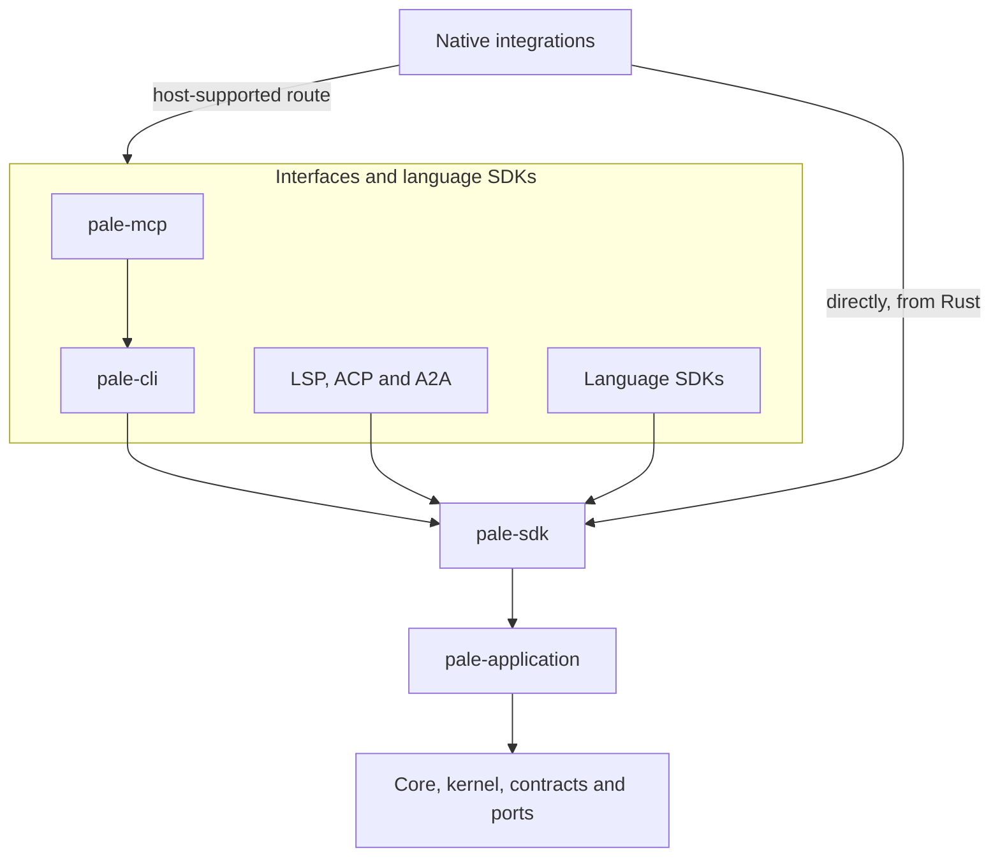

# Pale

Every coding tool asks for permissions and context at each step, and a person who works across several repositories, companies and clients repeats the same rules to each tool in every session. Pale is the meta harness through which Weave, Scope, Counsel, RawFish and Gazette act, a harness over the tools people already use; RawFish and Gazette run alone, and Pale may coordinate them. Write your world once, and Pale compiles it into the permissions and context the coding tools you already use ask for at every step. It gives people and their agents a compiled account of the world they work in: who is involved, what belongs to whom, which work connects and what each participant may do. Today its local tools answer what applies to a repository, what a proposed change would affect and which guidance files it would generate. The problem now in front is the path from a Claude Code or Codex hook to Pale's resident, a service on the person's machine: the hook asks what may happen and what context the agent needs, and the answer has to be one the host enforces. Changes reach the next person or agent through references to the owner's records, so they can continue without another retelling. With no agents involved, the same design coordinates people's identities, access and work.

Pale is the language and compiler; each person's workspace is their program. It holds a declared world steady while work runs, then checks proposed changes before a new version takes over. Work and its results can inform improvements between runs, while the live system stays within its declared limits. Evaluation, adoption and the owning product's release remain separate steps.

Pale keeps genealogy, the history of context: an append-only map of references that shows where work came from, what it relied on and what followed, while each record stays with its owner. The resident components keep its edges as tested records. Scope's write-back is the work in front: once it is built, Scope stores the context packet it gave an agent and genealogy holds a pointer to it, so a trace can say what the agent had when it acted. Once Scope's write-back completes that chain, from what an agent was given to what it did and what followed, it is what Reckon, Causality's evaluation laboratory, learns from.

Harsh is Pale's author and originator; RawThoughts Enterprises Private Limited owns the product and distribution. Version 0.0.1 is unreleased: there is no release to install, and you build it from source.

## What you can try now

The local tools compile Pale Workspace declarations and Packages, inspect the resulting configuration, compare a proposed change and prepare repository guidance. Packages combine reusable Markdown methods with typed TOML declarations. The command line, agents, editors and language SDKs use the same Rust application behavior.

Start with [Getting started](docs/getting-started.md) to build the CLI and try a built-in computation that normalizes a path list without reading or changing files. Then use the [workspace example](docs/workspace.md#try-a-complete-portable-workspace) to compile declarations, or the [repository-guidance starter](docs/examples/guidance-workspace/README.md) to review and install selected instructions for Codex or Claude Code while preserving the repository's own instructions. The [Package library](packages/README.md) holds the reusable methods.

These tools work before resident activation; native tools and project permissions still govern execution. The ordinary executables do not discover or start a resident. The CLI can send a hook event through an explicitly configured connection, but that connection still blocks native work. Tested resident components and embedded connections are described below. Joining them into the running service, and showing that an agent host enforces its answers, is the problem in front.

## Keep each system responsible for its work

Pale is for configuration and coordination rules that need to work across several tools. The resident path, whose components are tested but not yet joined into a running service, checks the route and permissions, carries work to its owner and connects the reported result to the request. For example, configuration review distinguishes an operation with no binding from a bound operation that lacks a required provider; neither proves a running provider or a completed external action.

A native owner that already meets the need can be used directly. Whatever holds a chat, a task, a source index, a memory, a model or a publication stays the owner of it: connected applications retain their data, identities, permissions and records of completed work, and Pale coordinates their use without replacing any of them.

## One implementation behind the interfaces

The Rust engine crates own compilation, application rules and resident behavior. SDKs and interfaces expose those operations; adapters perform I/O, and integrations connect the supported host interfaces.

Pale v0.0.1 stays in one modular repository, without Git submodules. The root Cargo workspace builds the inward engine and adapters; SDKs, interfaces and integrations retain independent manifests and build commands. The [source layout](docs/source-layout.md) maps their homes and dependency rules.

The main client paths lead inward to the shared behavior. Each arrow means “uses”:

Native integrations use only the route their host supports: an interface, a language SDK or, for a Rust component, pale-sdk directly. They do not provide another path to Pale internals.

Each interface has a defined job:

- pale-cli has one internal Pale dependency: pale-sdk.
- pale-mcp projects the reusable CLI command dispatcher. It does not parse terminal output or reconstruct application behavior.
- pale-lsp provides compiler-backed Pale Workspace authoring support through the editor-safe part of pale-sdk. It is not a general language server for repositories on which agents happen to work.
- pale-acp conducts one caller-supplied stable-v1 coding-agent connection. It owns no agent loop, transcript, filesystem authority, or native effect.
- pale-a2a can inspect one canonical `Delegate` handle without a resident. With a caller-provisioned authenticated `ResidentAttachment`, it can also start, advance, observe, and cancel a `Delegate` through the resident-owned operation service. The interface does not discover a resident or provide production signing, anti-rollback storage, or a deployment-qualified HTTPS carrier.
- Go and Python expose the operations registered as eligible for each of them, which Go lists through `Capabilities()` and Python through `capability_ids`; complete parity with the Rust API is the work in front. Operations outside that set are not exposed. Node and capability-confined WASM deliberately expose smaller sets. Unsupported operations remain explicit, and every shared operation retains one semantic owner.
- Native integrations translate host identities, permissions, events, effects, and read-back through the appropriate interface or SDK. They do not copy compiler, diagnostic, graph, or provider semantics.

## Connect to a resident from an embedding application

The source contains resident-state, recovery, provider-dispatch, consultation and A2A components with focused tests. The generated [bundle identity](contracts/conformance/cross-leaf.v1/bundle-identity.json) identifies the portable contract set used by these surfaces.

The Rust SDK exposes resident operations through a caller-supplied, authenticated `ResidentAttachment`. Embedded CLI, MCP and A2A paths can use it. The calling application provides the connection and response checks; this is not automatic resident discovery by an ordinary executable. Production signing, anti-rollback storage, installation and deployment-qualified external effects still require their own integration and qualification.

## Private configuration stays outside the reusable distribution

Pale ships no person's settings. Your own workspace, kept in a separate repository, chooses the Packages, declares your projects, execution workspaces and repositories, and binds them to your machines and providers. Compiling that configuration does not start a resident or cause any outside effect.

## Licence and credits

Pale's implementation and Package corpus use [AGPL-3.0-or-later](LICENSE). Generated contracts and thin language bindings use [Apache-2.0](contracts/LICENSE), as identified by their manifests. The binding's licence does not change the licence of the engine it links or embeds. Third-party material keeps its own terms and required notices.

Pale's Packages began from [ECC at `591ab5c`](https://github.com/affaan-m/ECC/tree/591ab5cbd3f2f65860ea91c226e410b1502c8e2e) and [ponytail at `16f2980`](https://github.com/DietrichGebert/ponytail/tree/16f29800fd2681bdf24f3eb4ccffe38be3baec6b), both MIT. We rewrote most of it; [NOTICE](NOTICE) gives the counts. [Package notices](packages/NOTICE) credit the other adapted methods and preserve their terms, and [THIRD_PARTY_LICENSES](THIRD_PARTY_LICENSES) keeps the retained upstream licence texts. The release job generates the dependency inventory for each artifact it ships; none is committed here, and an inventory of the source does not establish what a binary contains.

Commercial use is permitted under the applicable licence. Alternative terms require a separate written agreement with RawThoughts Enterprises Private Limited; this repository grants none. See [NOTICE](NOTICE) for ownership, [CITATION.cff](CITATION.cff) for citation and [CONTRIBUTING.md](CONTRIBUTING.md) for contribution requirements. Outside contributions remain closed pending review of the [draft agreement](CLA.md) and a way to record acceptance.
