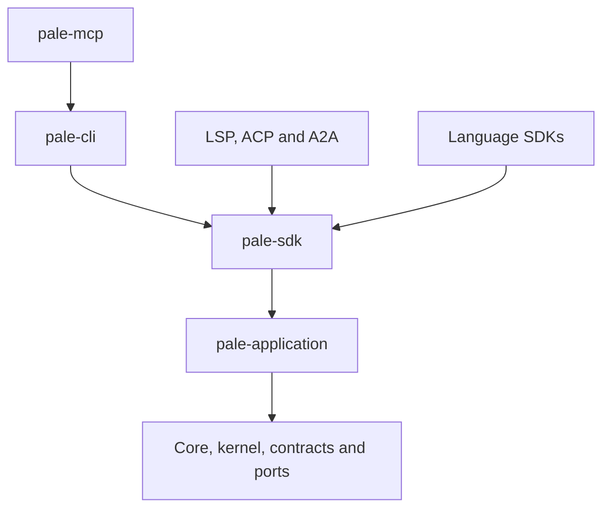

# Source layout

Change compiler behavior in the engine, host behavior in an integration and shared procedures in a Package. These components have their own source folders and manifests in one Git repository, with no Git submodules.

| Folder | What it holds |
| --- | --- |
| `crates/` | Engine code: `pale-core`, `pale-kernel`, `pale-contracts`, `pale-contract-codegen`, `pale-ports` and `pale-application` |
| `adapters/` | Filesystem and process I/O, the SQLite control store, local sockets, A2A exchange, etcd anchor storage and the macOS signing helper |
| `sdk/` | `pale-sdk` and the Python, JavaScript, Go and WebAssembly SDKs, plus the scene compiler |
| `interfaces/` | The command line, MCP, language server, ACP, A2A and the resident's local listener host |
| `integrations/` | One thin integration per product Pale works with |
| `packages/` | Reusable working methods and guidance for agents |
| `contracts/` | Schemas generated from the Rust wire models, and shared conformance vectors |
| `docs/` | This manual |
| `benchmarks/`, `tools/` | Performance measurements and repository checks |

## Dependencies run one way

Arrows point from the caller toward the layer that serves it.



`pale-cli` depends on `pale-sdk` alone within Pale. `pale-mcp` calls the CLI dispatcher directly, without parsing terminal output. The other client interfaces call the SDK. Each product integration uses the interface or SDK its host supports. Integrations never import engine internals or another integration.

The [resident listener host](../interfaces/resident/README.md) builds the server from the application service, Unix-socket adapter and work-turn coordinator. It depends directly on the application, adapter and ports. Its Rust library runs on an event loop the caller manages. To install a resident, supply authentication and trust inputs the service accepts, connect a signer and anchor, and verify that startup works with those settings. The macOS signer and etcd anchor supply mechanisms for those bindings. The filesystem adapter uses the same protected reader for endpoint and signer-policy data.

The maintainer [trust and recovery design](maintainers/trust-and-recovery.md) keeps proposed storage, signing and recovery contracts together. It distinguishes implemented components from the later offline procedures and deployment work; it is not a guide to commands available in the ordinary executable.

The maintainer [agent-surface specification](maintainers/agent-surfaces.md) explains generated repository files, host configuration and the identities needed to join native tool events to Pale operations. It identifies the current components and the unfinished admission and enforcement path.

The [workspace-language contracts](maintainers/workspace-language.md) describe the full module language, cross-owner apply and staged activation. The implementation compiles local workspace and agent-guidance inputs; adopted modules, cross-owner apply and resident activation are not built. The [workspace manual](workspace.md) keeps the supported commands and examples separate from that implementation design.

The [component method](../packages/architecture/components.md) explains the reusable `dependency-direction` check: keep application rules independent of infrastructure. Pale's [interface dependency tests](../tools/repository-quality/tests/interface_dependencies.rs) supply the repository-specific check for the standalone interfaces and language SDKs, the resident composition and the A2A adapter. They inspect the declared Cargo dependency scopes, aliases, versions and sources against those components' allowed dependencies. They do not inspect every Rust import or establish that every business rule has the right owner.

Run this check from the repository root:

```sh
cargo test --manifest-path tools/repository-quality/Cargo.toml --locked --test interface_dependencies
```

## Split modules by responsibility

Use the same splitting convention across all Rust crates so a reader can carry what they learned from one crate into another. Each submodule owns one cohesive responsibility and opens with a `//!` comment explaining it. Names follow the particular module's responsibilities; a renderer and a filesystem adapter need not have the same child names.

When a module acquires a second responsibility, separate the concerns during that work. Keep the root thin: its module documentation, declarations and re-exports preserve the public API while the child modules own the implementation. Keep helpers private or visible only to the smallest scope that needs them. Splitting a file must not expose new production API merely to make the split compile.

Keep Rust test files under the crate's `tests/` directory. Integration tests exercise the public API. Internal unit tests can remain in the owning module's Rust scope through a `#[cfg(test)]` module declaration with `#[path]` pointing into `tests/`; their physical location does not require public helpers. Put repeated setup in shared test fixtures rather than copying it between cases, and keep those fixtures out of production builds. These are the same rules for new modules and for earlier splits touched by a change.

## Contracts are generated from Rust

Edit the Rust wire record when a contract changes. Regenerate the JSON Schemas under `contracts/` and run the conformance vectors in every language. Never edit the generated schemas by hand. Unreleased contracts stay at `v1`, with no aliases or compatibility readers.

From the repository root, use the checked-in descriptor manifest to generate schemas in a separate directory. Verify those files with the same inputs.

```sh
cargo run --locked -p pale-contract-codegen -- generate \
  contracts/bundle/agent-surface.v1/agent-surface-schemas.v1.json \
  /absolute/path/generated-contracts
cargo run --locked -p pale-contract-codegen -- verify \
  contracts/bundle/agent-surface.v1/agent-surface-schemas.v1.json \
  /absolute/path/generated-contracts
```

The descriptor registers the contracts. The Rust records define their structure. Generation fails when they disagree, and verification checks the resulting files against the generated bundle. Review that bundle before replacing the checked-in one, then use each SDK's maintainer instructions to regenerate its language types. Regenerate stale output from the owning source.

Give each working copy its own Cargo target directory. A reused target has emitted schemas from a disposable prototype instead of the live source. If bundle verification reports a mismatch from a reused target, repeat it in a fresh target before changing the checked-in schemas. Sharing targets across working copies needs that stale-generator failure reproduced and fixed first.

## Building and testing

Run the engine and adapter tests from the repository root.

```sh
cargo test --workspace --locked
```

Build and test interfaces, SDKs, integrations and `tools/repository-quality` from their own Cargo workspaces or package folders. Each check includes `cargo fmt --all -- --check`, Clippy with warnings denied and Rustdoc with warnings denied.

When changing how Gazette results enter Pale, run the Node checks in the [Gazette integration](../integrations/gazette/README.md).

## Prepare guides and API reference together

[`tools/prepare_reference.py`](../tools/prepare_reference.py) captures one selected working copy, including uncommitted source and the complete manual, and rebuilds the public JavaScript and WebAssembly declarations. It runs the SDK build, declaration, ABI and packed-consumer checks in a disposable working copy with its own Cargo target, incremental compilation off and compiler wrappers disabled. Rust dependencies must already be available offline; Node.js 22 or later, npm, Cargo, rustc and wasm-pack must be on PATH. npm installs the locked development dependencies needed for these checks.

Supply the publishing workspace's three source-option files explicitly. TypeDoc options must omit installed plugins, and Rustdoc options must omit tool paths: the consuming workspace selects those tools separately. The preparer preserves the option files' exact bytes.

```sh
python3 tools/prepare_reference.py \
  --source /absolute/path/pale \
  --output /absolute/path/fresh-prepared-source \
  --typedoc-options /absolute/path/typedoc-options.json \
  --typescript-config /absolute/path/tsconfig.json \
  --rustdoc-options /absolute/path/rustdoc-options.json
```

The output parent must exist and the output directory must be new. Keep it outside the selected source or in an ignored build directory. Do not edit the selected source during preparation: a changed file, mode or file inventory rejects the capture. The working copy must match that source before commands run and afterward, except for explicitly rebuilt SDK outputs. Symlinked source members are rejected. Generated declarations, their WebAssembly companions, Node type declarations and the actual packed contracts dependency accompany the captured Rust source and manual. `preparation.json` records source identity, tools, attempted commands, results, declarations and the complete prepared tree; `.reference-preparation/` retains command logs and the contracts archive. A command that cannot start or is interrupted retains its error and available log, with no claimed exit code. A failed run records its failure and cannot be used as a completed source.

Preparation does not run TypeDoc or Rustdoc. Select the completed tree for both the manual and reference generators so they describe the same code. The native checks establish the selected platform's behavior; they do not establish a cross-platform release or publication approval.

## Distribute Package sources

[Package source bundles](package-source-bundles.md) shows how to archive a Package with its dependencies, check the extracted files and verify that the links between resources work in the receiving host.

## Contributing

Outside contributions can open once the contributor agreement has passed legal review and the project has a way to record acceptance. See [CONTRIBUTING.md](../CONTRIBUTING.md) for the engineering standard.
